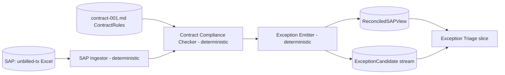
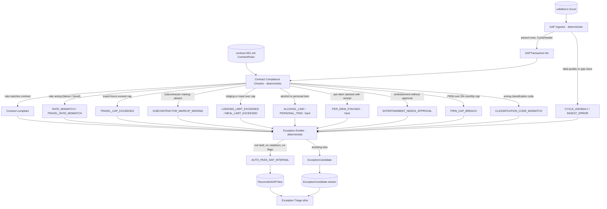

# Reconciliation — Agentic Flow Design

> Hackathon Day 2 slice. Companion to [`../participant-brief.md`](../participant-brief.md), [`document-extraction-flow.md`](document-extraction-flow.md), and [`exception-triage-flow.md`](exception-triage-flow.md).
> Scope: parse the unbilled-transaction Excel extract into a typed `SAPTransaction[]` list, validate every transaction against the structured rules in `contract-001.md`, produce a consolidated SAP-side ground truth, and emit a typed stream of exception candidates for the triage slice to resolve.
> Out of scope: draft invoice parsing, document matching, PL email interpretation, contract-rule *overrides* (PL approvals, PFA countersigns, standing precedent), prior-exception precedent, HITL — all of these belong to [`exception-triage-flow.md`](exception-triage-flow.md).

---

## 1. TL;DR

Reconciliation is deliberately narrow and fully deterministic. Three stages:

1. **SAP Ingestor** (deterministic) parses the unbilled-transaction Excel extract into a typed `SAPTransaction[]` list, assembles a `CycleHeader`, and flags any data-quality or data-gap issues.
2. **Contract Compliance Checker** (deterministic) validates every `SAPTransaction` against the structured rules in `contract-001.md` — role rates, travel caps, subcontractor markup, expense limits, non-reimbursable categories, and the invoice classification code — and attaches typed violation records to each transaction.
3. **Exception Emitter** (deterministic) categorises every transaction into either a clean pass or a typed `ExceptionCandidate`, then hands the stream to the triage slice.



No LLM lives in this slice. Every stage is plain arithmetic, table lookups, or structured-data parsing — all deterministic and replayable. That's the governance seam: reconciliation is the solid, auditable floor; triage is where interpretation happens.

---

## 2. Why "narrow and fully deterministic"

In a financial system "reconciliation" has to be the trustworthy floor that an auditor will sign off on without reading a prompt log. Three implications:

- **Fully deterministic.** The unbilled-transaction Excel is structured data — every field in every row is typed. Contract rules are structured too: the rate table is a markdown table with exact USD values, expense caps are numeric bounds, the non-reimbursable list is an explicit enum, the classification code is a literal string. All checks in this slice reduce to arithmetic or table lookups. No prompt, no temperature, no LLM. If the slice disagrees with itself on a re-run with the same inputs, that is a defect.
- **Contract rules belong here, contract-rule *overrides* do not.** Detection (does this TX violate a contract rule?) is deterministic and lives here. Resolution (did the PL approve the over-cap meal? does a precedent record auto-resolve the markup issue?) requires reading intent from prose and belongs in triage.
- **No decisions.** Reconciliation produces `ExceptionCandidate` records; it does not resolve them, auto-resolve them, or route them to a human. Every judgment call (does this receipt match? did the PL approve the over-cap? is there a standing precedent?) belongs to triage.

The hackathon brief's §14 note on data scope reinforces this split: the unbilled-transaction extract is the SAP source of truth for what was submitted; backup documents are the source of truth for what was spent. Comparing those two is the next step — in triage. In production this slice extends to a full three-way reconciliation (adding draft invoice as a third leg); the triage slice already assumes the SAP side has been reconciled first.

---

## 3. Design principles

1. **One job per stage.** Each stage has a single, documented contract.
2. **Fully deterministic.** No LLM anywhere in this slice. Every operation is arithmetic, a table lookup, or structured-data parsing.
3. **Idempotency.** Running the slice twice on the same inputs produces byte-identical output. Required for safe re-runs after upstream SAP fixes.
4. **Immutable evidence.** Every event — ingestion, contract check, exception emission — is appended to a per-TX evidence record. Cycle-level anomalies get their own `CycleEvidenceRecord` entry.
5. **No judgment.** This slice detects, categorises, and hands off. It never decides.
6. **Seams, not silos.** The output contracts (`ReconciledSAPView`, `ExceptionCandidate`) are stable so triage can consume them without rework.

---

## 4. End-to-end flow



Internally-consistent lines still become `ExceptionCandidate` records if they carry system flags, holds, or categorical attention markers from the SAP Ingestor. "Internal consistency" and "needs no attention" are two separate predicates — a TX can pass the first and fail the second.

---

## 5. Stage detail

### 5.1 SAP Ingestor (deterministic)

Parses the unbilled-transaction Excel export into a typed `SAPTransaction[]` list. Fully deterministic — no LLM.

**Source:**
- `unbilled-2026-04.xlsx` (or `.csv` export) — one row per transaction; all fields structured. This is the only SAP artefact consumed by this slice.

**Parser pipeline:**

1. **Excel / CSV parser** → one `SAPTransaction` per row, with fields: `tx_id`, `project_id`, `task_code`, `date`, `type`, `employee_id`, `role_code`, `description`, `category`, `quantity`, `unit`, `rate`, `amount`, `currency`, `hold_flag`, `hold_reason_raw`, `backup_ref`, `note`.
2. **Data-quality checks** → flag missing mandatory fields (`tx_id`, `project_id`, `date`, `amount`, `currency`), duplicate `tx_id` values, and unparseable dates or amounts. Rows that fail a mandatory-field check are emitted as `INGEST_ERROR` records and excluded from the downstream pipeline.
3. **Cycle header assembly** → derive `CycleHeader` from the row set: `project_id`, `cycle` (year-month from `date` range), `currency` (modal value; flag `CURRENCY_MIX` if more than one), section subtotals (labour, expenses by category), held-item count and total, and grand total — all computed by summation, no external input needed.
4. **Employee-gap check** → scan for employees who have expense rows but no corresponding labour rows in the cycle. Emit a `DATA_GAP` cycle-level anomaly (e.g. `E_7702_LABOUR_GAP`) so triage is aware before it tries to match documents.

**Output contract**

```json
{
  "tx_id": "TX-2026-04-0044",
  "project_id": "PRJ-NS-7421",
  "task_code": "T-200",
  "date": "2026-04-03",
  "type": "EXPENSE",
  "employee_id": "SUB-AERO",
  "role_code": null,
  "description": "Subcontractor invoice - drone survey",
  "category": "VENDOR",
  "quantity": 1.0,
  "unit": "EA",
  "rate": null,
  "amount": 2400.00,
  "currency": "USD",
  "hold_flag": false,
  "hold_reason_raw": null,
  "backup_ref": "VI-002",
  "note": null
}
```

Also emits a `CycleHeader` (project, cycle, currency, section subtotals, held-item total, grand total) and a `CycleAnomalyList` (data-gap and data-quality issues found during ingestion).

**Idempotency.** The parser is keyed on a content hash of the source file. Re-running on the same input produces byte-identical output.

### 5.2 Contract Compliance Checker (deterministic)

Validates every `SAPTransaction` in the Ingestor's output against the structured rules in `contract-001.md` and attaches a `contract_compliance` block to each transaction. Pure arithmetic and table lookups — no LLM.

**Why deterministic.** `contract-001.md` is already structured: the rate table is a markdown table with exact numeric values, the expense caps are quoted in USD, the non-reimbursable list is an explicit enum, and the classification code is a literal string (`STD-TM-NA-CIVIC`). Every check reduces to: *does this field equal the contract value, or fall within the contract bound?* That is a comparison, not a judgment. No free-text interpretation is required.

**Inputs:**

- `SAPTransaction[]` — the Ingestor's parsed output (one record per unbilled-transaction row).
- `ContractRules` — a structured object parsed from `contract-001.md`. For the hackathon prototype, this is hand-encoded as a typed config. In production it would be produced by a future `ContractIngestor` pre-stage (see §10).

```json
{
  "contract_id": "MSA-NS-2024-0418",
  "project_id": "PRJ-NS-7421",
  "currency": "USD",
  "classification_code": "STD-TM-NA-CIVIC",
  "role_rates": {
    "ENG1": 145, "ENG2": 175, "ENG3": 230,
    "PM1": 215, "PRIN": 320, "ADMIN": 95
  },
  "travel_rate_factor": 0.5,
  "travel_cap_hours_per_direction": 8,
  "subcontractor_markup_pct": 8,
  "expense_rules": {
    "lodging_cap_metro_usd": 275,
    "lodging_cap_other_usd": 195,
    "meal_cap_usd_per_day": 90,
    "per_diem_usd_per_day": 65,
    "per_diem_stackable_with_meal": false,
    "receipt_threshold_usd": 25,
    "alcohol": "NOT_REIMBURSABLE",
    "personal_items": "NOT_REIMBURSABLE",
    "entertainment": "REQUIRES_PL_APPROVAL"
  },
  "sap_notes": [
    { "rule": "PRIN_CAP_PCT", "value": 5, "scope": "monthly_hours", "source_date": "2025-02", "overridable": true }
  ]
}
```

**Checks and violation codes:**

| Check | Contract source | Violation code | Severity | Example from sample pack |
|---|---|---|---|---|
| Labour rate matches role-rate table | §3 rate table | `RATE_MISMATCH` | soft | Any labour TX whose `rate` ≠ contract rate for its `role_code` |
| Travel-time lines billed at 50% of role rate | §3 travel-time rule | `TRAVEL_RATE_MISMATCH` | soft | A travel line billed at full rate |
| Travel time ≤ 8 h per traveller per direction | §3 travel cap | `TRAVEL_CAP_EXCEEDED` | soft | Travel time block > 8 h |
| Subcontractor pass-through includes +8% markup | §3 subcontractor rule | `SUBCONTRACTOR_MARKUP_MISSING` | soft | TX-0044: cost only, no markup line (supersedes `SUBCONTRACTOR_WITHOUT_MARKUP` detection from SAP system flag) |
| Lodging ≤ USD 275/night metro, USD 195 elsewhere | §4 lodging cap | `LODGING_LIMIT_EXCEEDED` | soft | TX-0040 hotel stay (PL email override exists; triage resolves) |
| Meals-with-receipt ≤ USD 90/day/traveller | §4 meal cap | `MEAL_LIMIT_EXCEEDED` | soft | TX-0043 dinner USD 118 (PL email override exists; triage resolves) |
| Per-diem and meal receipt not on same day/traveller | §4 non-stackable | `PER_DIEM_STACKED` | hard | Same-day per-diem + receipt submission |
| No alcohol | §4 alcohol | `ALCOHOL_LINE` | hard | TX with category ALCOHOL or description matching alcohol |
| No personal items | §4 personal items | `PERSONAL_ITEM` | hard | TX category PERSONAL |
| Entertainment only with PL approval on file | §4 entertainment | `ENTERTAINMENT_NEEDS_APPROVAL` | soft | TX-0046 airport lounge (PL email "drop"; triage resolves) |
| Expense > USD 25 (not mileage / per diem) has `backup_ref` | §4 receipt threshold | `RECEIPT_REQUIRED_MISSING` | soft | Any expense TX above threshold without a `backup_ref` |
| Mileage billed at prevailing federal rate | §4 mileage | `MILEAGE_RATE_MISMATCH` | info | Mileage rate on TX differs from config |
| Cycle classification code = `STD-TM-NA-CIVIC` | §5 invoicing | `CLASSIFICATION_CODE_MISMATCH` | soft | `cycle_header.classification_code` set to a different value |
| PRIN hours ≤ 5% of monthly hours | SAP note 2025-02 | `PRIN_CAP_BREACH` | soft | PRIN TX-0013 (hold already applied by SAP; this check confirms the underlying rule) |

Severity semantics: **hard** = deterministically non-reimbursable per contract; no amount of triage precedent removes the block (though triage's HITL surfaces the decision). **soft** = contractual limit with a known override path (PL approval, PFA countersign). **info** = informational flag for completeness; does not force an exception route.

**Output contract — `contract_compliance` block (attached to each `SAPTransaction`):**

```json
{
  "tx_id": "TX-2026-04-0044",
  "contract_compliance": {
    "status": "VIOLATION",
    "violations": [
      {
        "code": "SUBCONTRACTOR_MARKUP_MISSING",
        "severity": "soft",
        "rule_citation": "contract-001.md §3 — Subcontractor pass-through at cost plus 8%",
        "detail": "TX amount USD 2,400.00 is cost only. Markup of USD 192.00 (8%) not present as a separate line.",
        "expected": 2592.00,
        "actual": 2400.00
      }
    ],
    "checked_at": "2026-05-01T08:15:52Z",
    "contract_rules_version": "MSA-NS-2024-0418"
  }
}
```

A TX with no violations receives `"status": "PASS"` and an empty `violations[]`.

**Cycle-level contract check.** One additional check runs at cycle scope rather than per-TX: the `cycle_header.classification_code` comparison (`CLASSIFICATION_CODE_MISMATCH`). This is attached to the `CycleHeader`, not to any single transaction.

**ContractRules sourcing.** For the hackathon prototype the `ContractRules` object is hand-encoded from `contract-001.md` and pinned to the same cycle run as the SAP artefacts. In production it would be emitted by a `ContractIngestor` pre-stage that parses the contract source (structured MD, PDF, or SAP contract record) and caches the result keyed on `(contract_id, effective_date)`. See §10 open questions.

---

### 5.3 Exception Emitter (deterministic)

Reads each `SAPTransaction` (enriched with its `contract_compliance` block from §5.2) and categorises it. One of two outcomes per TX:

- `AUTO_PASS_SAP_INTERNAL` — the TX is not held AND has no contract-compliance violations AND carries no structural flags. It passes through to the `ReconciledSAPView`; triage will still try to match it against a backup document but needs no further SAP-side work.
- `ExceptionCandidate` — the TX needs triage attention for one or more typed reasons.

**Exception taxonomy (what triggers each candidate type):**

Codes are grouped by source: **SAP-side** (from the Ingestor's hold flag and data-gap checks), **contract-compliance** (from §5.2 Contract Compliance Checker), and **structural** (backup-ref and FX signals from the Ingestor).

*SAP-side codes (from §5.1 Ingestor):*

| Candidate code | Trigger | Example from sample pack |
|---|---|---|
| `SAP_HOLD` | `hold_flag=true` on the unbilled-tx row | TX-0013 (PRIN cap), TX-0045 (mis-coded), TX-0047 (PMO) |
| `CYCLE_ANOMALY` | Attached at cycle level; data-gap or data-quality issue found during ingestion | `E_7702_LABOUR_GAP` (expense rows, no labour rows for employee) |

*Contract-compliance codes (from §5.2) — each carries `severity` and `rule_citation`:*

| Candidate code | Trigger | Severity | Rule citation | Example from sample pack |
|---|---|---|---|---|
| `RATE_MISMATCH` | Labour TX `rate` ≠ contract rate for `role_code` | soft | §3 rate table | Any labour line at a non-standard rate |
| `TRAVEL_RATE_MISMATCH` | Travel-time line not at 50% of role rate | soft | §3 travel-time rule | Travel billed at full rate |
| `TRAVEL_CAP_EXCEEDED` | Travel hours > 8 h per traveller per direction | soft | §3 travel cap | >8 h travel block |
| `SUBCONTRACTOR_MARKUP_MISSING` | VENDOR/subcontractor TX without a +8% markup line | soft | §3 subcontractor pass-through | TX-0044 (cost only, markup absent; supersedes `SUBCONTRACTOR_WITHOUT_MARKUP`) |
| `LODGING_LIMIT_EXCEEDED` | Lodging > USD 275/night metro or USD 195/night other | soft | §4 lodging cap | TX-0040 (PL email override; triage resolves) |
| `MEAL_LIMIT_EXCEEDED` | Meal-with-receipt > USD 90/day/traveller | soft | §4 meal cap | TX-0043 dinner USD 118 (PL email override; triage resolves) |
| `PER_DIEM_STACKED` | Per-diem + meal receipt on same day, same traveller | hard | §4 non-stackable rule | Same-day dual submission |
| `ALCOHOL_LINE` | TX category or description indicates alcohol | hard | §4 alcohol — not reimbursable | TX-0029 (hotel folio alcohol line) |
| `PERSONAL_ITEM` | TX category = personal items | hard | §4 personal items | Personal-item line on expense report |
| `ENTERTAINMENT_NEEDS_APPROVAL` | Entertainment TX without a PL approval on file | soft | §4 entertainment rule | TX-0046 airport lounge |
| `RECEIPT_REQUIRED_MISSING` | Expense > USD 25 (not mileage/per diem) without `backup_ref` | soft | §4 receipt threshold | Any receipt-required TX missing a doc reference |
| `MILEAGE_RATE_MISMATCH` | Mileage at non-federal rate | info | §4 mileage rule | Mileage TX at stale rate |
| `CLASSIFICATION_CODE_MISMATCH` | `cycle_header.classification_code` ≠ `STD-TM-NA-CIVIC` | soft | §5 invoicing | Cycle with wrong SAP classification |
| `PRIN_CAP_BREACH` | PRIN hours > 5% of cycle monthly hours | soft | SAP note 2025-02 | TX-0013 (SAP hold already applied; this confirms the rule) |

*Structural codes (from Ingestor enrichment):*

| Candidate code | Trigger | Example from sample pack |
|---|---|---|
| `BACKUP_REF_PRESENT_NEEDS_MATCH` | TX has a `backup_ref` populated | TX-0022 (RC-001), TX-0044 (VI-002). All expense TXs with backup refs need triage to confirm the match |
| `FOREIGN_CURRENCY` | `currency` differs from `cycle_header.currency` | TX-0048 (CAD on USD project) |

> **Note on `SUBCONTRACTOR_WITHOUT_MARKUP`:** This code is retired in favour of `SUBCONTRACTOR_MARKUP_MISSING`, which is detected deterministically by §5.2 against the contract rate (+8%). Any legacy references to `SUBCONTRACTOR_WITHOUT_MARKUP` are aliases and should be treated identically.

A single TX can carry multiple exception codes — they are additive, not exclusive. The emitter does not prioritise; the triage slice's Confidence Router does.

**Output contract — `ExceptionCandidate`**

```json
{
  "candidate_id": "EC-2026-04-0044-01",
  "tx_id": "TX-2026-04-0044",
  "codes": ["SUBCONTRACTOR_MARKUP_MISSING", "BACKUP_REF_PRESENT_NEEDS_MATCH"],
  "sap_transaction_ref": "TX-2026-04-0044",
  "contract_violations": [
    {
      "code": "SUBCONTRACTOR_MARKUP_MISSING",
      "severity": "soft",
      "rule_citation": "contract-001.md §3 — Subcontractor pass-through at cost plus 8%",
      "expected": 2592.00,
      "actual": 2400.00
    }
  ],
  "hold_flag": false,
  "hold_reason_raw": null,
  "backup_ref": "VI-002",
  "amount": 2400.00,
  "currency": "USD",
  "cycle": "2026-04",
  "project_id": "PRJ-NS-7421",
  "emitted_at": "2026-05-01T08:16:04Z"
}
```

The `ReconciledSAPView` is the full consolidated SAP picture — every `SAPTransaction`, every `CycleAnomaly`, every reconciliation discrepancy — and travels with the exception stream as context so triage never has to re-fetch SAP.

---

## 6. Hand-off to Exception Triage

Two typed streams, both consumed by [`exception-triage-flow.md`](exception-triage-flow.md):

- `ReconciledSAPView` — the parsed unbilled-transaction picture for the cycle, including every `SAPTransaction`, per-TX `contract_compliance` blocks, the `CycleHeader` (section subtotals, held-item total, grand total), and a cycle-level `contract_compliance_summary` (counts of hard/soft/info violations). Triage uses it as the authoritative SAP ground truth. One per cycle.
- `ExceptionCandidate[]` — the typed stream of items needing triage. One per TX that failed any attention predicate (SAP hold, contract-compliance violation, or structural flag). Cycle-level anomalies (data gaps, ingestion errors) are carried on the `ReconciledSAPView.cycle_anomalies`.

The `contract_compliance_summary` shape:

```json
{
  "contract_rules_version": "MSA-NS-2024-0418",
  "total_txs_checked": 52,
  "pass": 38,
  "violations": {
    "hard": 1,
    "soft": 8,
    "info": 2
  },
  "violation_codes_present": ["SUBCONTRACTOR_MARKUP_MISSING", "LODGING_LIMIT_EXCEEDED", "MEAL_LIMIT_EXCEEDED", "RECEIPT_REQUIRED_MISSING", "PRIN_CAP_BREACH", "ALCOHOL_LINE"]
}
```

A TX classified as `AUTO_PASS_SAP_INTERNAL` is only "SAP-side clean with no contract violations and no structural flags." Triage still runs document matching against it (because a receipt may itself contain a non-reimbursable line or an amount variance). But the SAP side and the contract check both need no further work on that TX.

---

## 7. Evidence writing

Append-only, same pattern as the extraction slice. One record per `tx_id` plus one `CycleEvidenceRecord` per cycle. Events written by this slice:

- `SAP_INGESTED` — Ingestor output per TX: all parsed fields, the row's source hash, any data-quality flags. One `CYCLE_INGESTED` event at cycle level carries the `CycleHeader` and any `CYCLE_ANOMALY` records (e.g. `E_7702_LABOUR_GAP`).
- `CONTRACT_CHECKED` — Contract Compliance Checker result per TX: the `contract_compliance` block with every violation code, severity, rule citation, expected vs. actual values, and the `contract_rules_version` used. For the cycle-scope classification-code check, one `CONTRACT_CHECKED` event is written at cycle level on the `CycleEvidenceRecord`.
- `EXCEPTION_EMITTED` — Exception Emitter decision (either `AUTO_PASS_SAP_INTERNAL` or the full `ExceptionCandidate`)

Together these three events let an auditor reconstruct exactly what the unbilled-transaction extract contained, which contract rules each transaction violated and why, and why each TX did or did not become an exception — all before triage touched anything.

---

## 8. Mapping to the brief §7 KPIs

Reconciliation contributes to a subset of the KPIs; the biggest levers (Analyst-hours reduction, exceptions resolved without PL, first-pass approval rate) are mostly driven by [`exception-triage-flow.md`](exception-triage-flow.md).

| KPI | How this slice contributes |
|---|---|
| **Critical compliance failures = 0** | Per-TX evidence trail; fully deterministic — no LLM, no prompt drift. Hard contract rules (alcohol, personal items, per-diem stacking) caught and flagged with `rule_citation` before any triage judgment runs. Reconciliation is the auditable floor. |
| **Billing Analyst hours per invoice ≥ 50% reduction** | Eliminates the manual contract-rate cross-check that today happens in Excel. Clean lines pass through with zero touch. Contract-compliance candidates arrive at triage already typed and cited, so no analyst re-reads the contract to form the question. |
| **Invoice cycle time ≥ 25% reduction** | Contract violations (rate mismatches, missing markup) are surfaced as soon as the unbilled-transaction extract is parsed — not discovered later when the PL is reviewing the draft. |
| **Document data-extraction accuracy ≥ 90%** | Not addressed here. Owned by the extraction slice. |
| **Exceptions resolved without PL ≥ 55%** | Partly addressed. Hard contract violations (alcohol, personal items) are deterministically typed here; triage's precedent engine can auto-resolve recurring hard-violation patterns (e.g. exclude known-alcohol line on hotel folio) without involving the PL. |
| **First-pass PL approval ≥ 90%** | Materially addressed. Per-TX contract-compliance verdicts mean triage can present PL-visible items with no SAP-side ambiguity and no contract-rate surprises. The PL sees a package where every exception has a typed reason and a rule citation. |

---

## 9. What's deliberately not in this slice

- **No draft invoice.** The SAP draft invoice is out of scope for this slice. Only the unbilled-transaction Excel extract is consumed. When the draft invoice is needed in future (e.g. for three-way reconciliation), a `DraftInvoiceIngestor` stage would be added without restructuring this slice.
- **No document matching.** Receipts, folios, vendor invoices live in triage.
- **No PL emails.** Any email interpretation (contract overrides, hold releases, etc.) belongs to the triage slice's Instruction Capture sub-pipeline.
- **No contract-rule *overrides*.** Reconciliation enforces contract rules deterministically — it detects violations and assigns severity. But *resolving* those violations (a PL email approving an over-cap meal, a PFA countersigning a lodging exception, a precedent record auto-resolving a recurring markup issue) belongs entirely to triage. Hard violations flagged here cannot be quietly removed; they must be explicitly accepted or rejected by a human in triage's HITL queues.
- **No prior-exception precedent.** Memory lookup belongs to triage.
- **No HITL.** Reconciliation is a batch job that runs to completion; triage is where the queues live.
- **No SAP writes.** Reconciliation only reads SAP outputs.

Every seam above has a clear hand-off contract so the downstream slice can be built without revisiting this one.

---

## 10. Open questions for the next working session

- **Hold-reason classification.** The CSV `hold_reason_raw` field contains free text written by SAP (e.g. "PRIN cap exceeded", "mis-coded internal training"). Without the draft invoice's LLM hold-type classifier, triage must read `hold_reason_raw` directly or this slice adds a lightweight keyword-based classifier. Decision: accept raw text for now (triage precedent lookup operates on `hold_reason_raw`); revisit if triage retrieval quality is poor.
- **Three-way extension.** This design is single-source (unbilled-tx Excel only). The brief's §14 production target is three-way (draft invoice + unbilled-tx + backup documents). The clean extension is: add a `DraftInvoiceIngestor` stage that feeds an `InternalReconciler` between §5.1 and §5.2, then add backup-document extracts as a third leg — no restructuring of this slice's Contract Compliance or Exception Emitter stages needed.
- **Cycle anomaly severity policy.** `E_7702_LABOUR_GAP` is surfaced as `warning` severity; some anomalies may warrant blocking triage from running until resolved. Needs a severity-to-action matrix.
- **ContractRules sourcing in production.** For the hackathon the `ContractRules` object is hand-encoded from `contract-001.md`. In production it should be emitted by a `ContractIngestor` pre-stage that parses the authoritative contract source — structured SAP contract record, Markdown export, or PDF — and caches the result keyed on `(contract_id, effective_date)`. The open question is who owns the parse quality and what happens when the contract PDF contains ambiguous or conflicting clauses (which should surface as a data-quality flag, not a silent mismatch).
- **Contract-rule versioning.** A contract may be amended mid-engagement. Which version of `ContractRules` applies to a given cycle? The safe default is: use the version whose `effective_date` is the latest date on or before the cycle's billing period end. Amendment history should be stored alongside the contract record so that re-runs against an old cycle use the rules that were in force at the time, not the current rules.
- **Soft-vs-hard policy maintenance.** The hard/soft classification in §5.2 reflects the current contract and legal interpretation. If a new contract clause changes (e.g. entertainment is reclassified from "requires PL approval" to "hard non-reimbursable"), the severity table needs an explicit update process. Recommend a policy-owner sign-off gate on any severity change, recorded in a `policy_changelog`.
- **Travel-cap scoping.** The §3 travel cap of 8 h per traveller per direction per trip requires a *trip grouping heuristic* to evaluate correctly — individual TX rows do not carry an explicit trip ID. A trip is likely inferrable from employee ID + date proximity + origin/destination description. This grouping logic should be specified before the checker is implemented; incorrect grouping could either over-flag (splitting a single trip across two billing rows) or under-flag (merging two trips).
