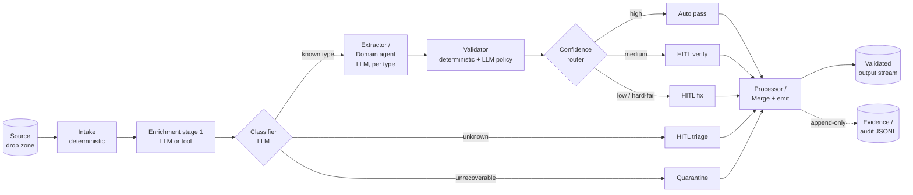
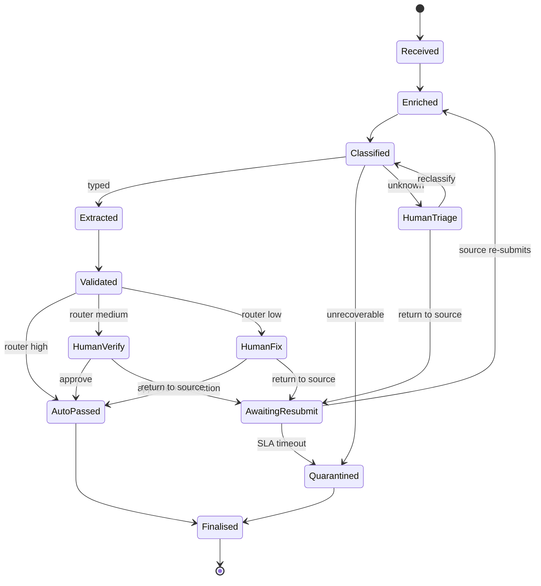

# Reusable Tech Architecture Flow

> Blueprint for building an **agentic pipeline** application: narrowly-scoped specialists, typed contracts, deterministic routing, HITL exits, and an immutable audit trail.
>
> **Reference implementation:** `meridian-atlas-partners` (document extraction for a professional-services billing workflow). See [`document-extraction-flow_plan.md`](document-extraction-flow_plan.md) for the domain narrative and [`implementation-plan.md`](implementation-plan.md) for a thinner hackathon slice using the same bones.
>
> This document is **domain-agnostic**: swap "document" for whatever unit of work your app processes (ticket, claim, email, order, patient chart, chat transcript…), and the shape still holds.

---

## 1. TL;DR — the shape in one picture



Three loops are allowed, each with a **hard cap**: composite→split, HITL→reclassify, submitter→re-upload. Everything else is a straight line.

---

## 2. Core design principles (the parts you port verbatim)

| # | Principle | Why it matters |
|---|-----------|----------------|
| 1 | **One job per stage.** Each stage has a single, documented I/O contract. | Narrow contracts → swappable stages → tunable individually. |
| 2 | **Deterministic by default.** LLM reasoning only where human judgment would otherwise be required. | Audit replay, cost, and reliability. |
| 3 | **Confidence is a first-class output.** Every agent emits per-field (or per-decision) confidence; a **separate router** makes the HITL/auto-pass decision. | No agent decides to "ask a human" itself — thresholds are config, not code. |
| 4 | **Pydantic (or equivalent) at every boundary.** YAML → config, LLM JSON → DTO, state → pipeline state. | Fails loudly at the boundary instead of silently downstream. |
| 5 | **One YAML config per agent.** The `model:` / `provider:` / `prompt_version:` / thresholds all live here. | Swap models or thresholds without touching code. |
| 6 | **Idempotent re-runs.** Re-running the pipeline is a no-op unless `--force` is passed. | Safe to rerun; checkpoint-friendly; easy to debug. |
| 7 | **Two log streams, kept separate.** Operational JSON logs **and** per-unit append-only evidence/audit JSONL. | Devs read one, auditors read the other. Never conflate them. |
| 8 | **HITL decides, doesn't invent.** A strictly-bounded set of analyst actions, each emitting one `DecisionEvent`. | The source document / data stays the authority; the human handles judgment and routing. |
| 9 | **Seams, not silos.** The output contract of each stage is the input contract of the next, and the final output contract is what the *next* slice consumes without rework. | Future slices (reconciliation, matching, UI) drop in without refactoring upstream. |
| 10 | **Secrets via env only.** Never hardcoded. Follow the enterprise security baseline (`.env` + `.gitignore`). | Table stakes. |

---

## 3. Reference tech stack (with explicit swap-points)

| Concern | Reference choice | What you can swap for |
|---|---|---|
| Language | Python 3.11+ | TypeScript / Go — the pattern is language-agnostic |
| LLM provider | Anthropic (`anthropic`) — model per agent in YAML | OpenAI, Bedrock, Vertex, Azure OpenAI |
| Pipeline orchestration | **LangGraph** (`StateGraph`, one graph per unit of work) | Temporal, Prefect, DIY async DAG |
| Domain contracts | **Pydantic v2** | Zod (TS), dataclasses + jsonschema, msgspec |
| CLI | **Typer** | `click`, `argparse`, `commander` |
| Operational logs | **structlog** → JSON | `loguru`, `pino`, OpenTelemetry logs |
| Config loading | **PyYAML** | TOML / JSON — unchanged pattern |
| State store (v1) | Filesystem (`local/<stage>/<id>.json`) | S3 + SQLite / Postgres + object store |
| Audit store (v1) | Append-only JSONL per unit (`local/evidence/<id>.jsonl`) | S3 Object Lock, Datomic, EventStore |
| Secrets | `.env` (python-dotenv) | AWS Secrets Manager, Vault, 1Password Connect |

**Lock in the pattern, swap the implementations.** Each row is independently replaceable.

---

## 4. Repository layout (the shape to copy)

```
<app-root>/
├── config/
│   ├── pipeline.yaml                 # paths, batch/cycle, logging
│   └── agents/
│       ├── <agent-1>.yaml            # one file per agent
│       ├── <agent-2>.yaml            #   model: lives here, nowhere else
│       └── <agent-N>.yaml
├── src/<pkg>/
│   ├── __main__.py                   # `python -m <pkg>` → cli.app()
│   ├── cli.py                        # Typer commands (one per stage + full pipeline)
│   ├── config.py                     # Pydantic configs + YAML loader
│   ├── contracts.py                  # Pydantic domain contracts (DTOs)
│   ├── log.py                        # structlog setup
│   ├── evidence.py                   # append-only audit writer
│   ├── graph.py                      # LangGraph wiring (nodes + edges + routing)
│   └── agents/
│       ├── <agent-1>.py              # exposes node(state) -> state
│       ├── <agent-2>.py
│       └── <agent-N>.py
├── data/                             # input samples / fixtures
├── local/                            # gitignored runtime output
│   ├── raw/<id>.json                 # intake output
│   ├── <stage>/<id>.json             # one dir per stage
│   ├── evidence/<id>.jsonl           # per-unit audit trail
│   └── logs/<app>.jsonl              # operational structlog stream
├── documentation/                    # design docs (this file lives here)
├── requirements.txt / pyproject.toml
├── .env                              # ANTHROPIC_API_KEY=…, never committed
└── .gitignore                        # must include .env and local/
```

**Rule of thumb:** anything under `config/` is tuned by a human; anything under `local/` is produced by the machine. Only `src/` and `config/` are versioned business logic.

---

## 5. The agent contract (every stage looks the same)

Each stage is a **module under `src/<pkg>/agents/`** that exposes a single public entry point:

```python
def node(state: PipelineState) -> PipelineState:
    """Read inputs off state, do one job, write typed outputs back."""
```

Plus (optionally) a lower-level helper so the stage can be driven from the CLI *without* going through the graph:

```python
def do_the_thing(input_dto, *, force: bool = False) -> tuple[OutputDTO, bool]:
    """Returns (output, fresh). fresh=False means the cached artefact was reused."""
```

Rules every node follows:

1. **Reads from and writes to `PipelineState`** — never from globals.
2. **Writes exactly one artefact** to `local/<stage>/<id>.json` (or the stage-specific queue dir for routing branches).
3. **Idempotent**: if the artefact exists and `force=False`, read it from disk and return it unchanged.
4. **Appends exactly one `EvidenceEvent`** per state transition.
5. **No cross-stage knowledge**: it must not know what runs before or after it; only what's in its input contract.
6. **Deterministic unless marked `type: llm`** in its YAML.

Example — the real `processor` node merges stage artefacts, no LLM:


```50:92:C:\git\AI\FDE-2\meridian-atlas-partners\src\meridian\agents\processor.py
def process(
    raw: RawDocRecord,
    layout: LayoutExtract,
    classification: ClassifierResult,
    extraction: Optional[DocumentExtract] = None,
    validation: Optional[ValidationResult] = None,
    *,
    force: bool = False,
) -> tuple[ProcessedDocument, bool]:
    # ... reads disk if cached, writes JSON + evidence event otherwise
```

---

## 6. One YAML per agent (the primary tuning surface)

Every LLM-driven agent gets its own `config/agents/<name>.yaml`. **The model name lives here, nowhere else in the repo.**

```yaml
# config/agents/<agent>.yaml
agent: <name>
type: llm            # or "deterministic" — then no provider/model/effort

provider: anthropic
model: claude-sonnet-4-6
effort: high         # low | medium | high | xhigh | max   (null for Haiku)
max_tokens: 2048

prompt_version: v1

# Any agent-specific tuning knobs — thresholds, caps, retries.
hitl_triage_min_confidence: 0.60

retries:
  max_attempts: 3
  backoff_seconds: 2
```

The pattern is enforced by a Pydantic class in `config.py`, loaded via a tiny generic loader:

```python
def load_agent_config(name: str, model_cls: Type[T]) -> T:
    path = repo_root() / "config" / "agents" / f"{name}.yaml"
    return model_cls(**_load_yaml(path))
```

That's the entire config layer. Adding a new agent is: write a Pydantic class → write the YAML → done.

---

## 7. Typed contracts at every boundary

Define the DTOs **once** in `contracts.py`. Every stage input and output is a Pydantic model.

```python
class RawRecord(BaseModel):          # intake output
    id: str
    source_uri: str
    received_at: datetime
    content_sha256: str
    byte_size: int
    status: Literal["new", "duplicate", "near_duplicate"] = "new"

class ClassifierResult(BaseModel):   # LLM output, validated at the boundary
    id: str
    type: DocType
    confidence: float = Field(..., ge=0.0, le=1.0)
    reasoning: str
    signals: list[str] = Field(default_factory=list)

class ExtractedField(BaseModel):
    value: Optional[str | float | int] = None
    confidence: float = Field(..., ge=0.0, le=1.0)
    span: Optional[str] = None       # pointer back to source evidence
```

**Why `confidence` on every field, not just the top-level result:** it's what lets the router make a per-field HITL decision. See §9.

---

## 8. Pipeline state and graph wiring (LangGraph)

A single Pydantic `PipelineState` carries everything a unit of work accumulates. Nodes mutate it; the graph routes on it.


```43:58:C:\git\AI\FDE-2\meridian-atlas-partners\src\meridian\graph.py
class PipelineState(BaseModel):
    """Mutable state carried through the per-doc graph."""

    model_config = ConfigDict(arbitrary_types_allowed=True)

    source_path: Path
    force: bool = False

    raw: Optional[RawDocRecord] = None
    layout: Optional[LayoutExtract] = None
    classification: Optional[ClassifierResult] = None
    extraction: Optional[DocumentExtract] = None
    validation: Optional[ValidationResult] = None

    errors: list[str] = Field(default_factory=list)
```

Wiring is tiny — every edge is explicit, routing lives in a single `_route_after_<stage>` function:


```90:122:C:\git\AI\FDE-2\meridian-atlas-partners\src\meridian\graph.py
def build_graph():
    """Compile the StateGraph for this slice."""
    graph = StateGraph(PipelineState)

    graph.add_node("intake", intake.node)
    graph.add_node("layout_extractor", layout_extractor.node)
    graph.add_node("classifier", classifier_agent.node)
    graph.add_node("extractor", extractor_agent.node)
    graph.add_node("validator", validator_agent.node)
    graph.add_node("processor", processor_agent.node)
    graph.add_node("quarantine", quarantine_agent.node)
    graph.add_node("hitl_triage", hitl_triage_agent.node)

    graph.set_entry_point("intake")
    graph.add_edge("intake", "layout_extractor")
    graph.add_edge("layout_extractor", "classifier")
    graph.add_conditional_edges(
        "classifier",
        _route_after_classifier,
        {
            "extractor": "extractor",
            "quarantine": "quarantine",
            "hitl_triage": "hitl_triage",
        },
    )
    graph.add_edge("extractor", "validator")
    graph.add_edge("validator", "processor")
    graph.add_edge("processor", END)
    graph.add_edge("quarantine", END)
    graph.add_edge("hitl_triage", END)
```

**Keep the graph flat.** Branching lives in `_route_after_X` functions, not nested subgraphs — easier to read, easier to replay.

---

## 9. The confidence router (deterministic thresholds, config-tunable)

Every agentic app needs **one** place that decides auto-pass vs HITL vs quarantine. It must be:

- **Pure code**, not an LLM call.
- **Driven by thresholds in YAML**, not hard-coded.
- **The only place** HITL routing happens.

Default routing table (copy-paste starting point):

| Signal | Route |
|---|---|
| Classifier `type == "unrecoverable"` | `QUARANTINE` |
| Classifier `type == "unknown"` or `confidence < triage_min` | `HITL_TRIAGE` |
| All required fields ≥ `auto_pass_min` **and** validator `status == ok` | `AUTO_PASS` |
| Any required field in `[verify_min, auto_pass_min)` **or** validator `warning` | `HITL_VERIFY` |
| Any required field < `verify_min` **or** validator `hard_fail` | `HITL_FIX` |

```yaml
# config/agents/<classifier>.yaml
hitl_triage_min_confidence: 0.60

# config/agents/<router>.yaml   (or inlined into pipeline.yaml)
confidence_thresholds:
  auto_pass: 0.90
  hitl_verify: 0.70
```

Thresholds are the **primary knob** for whatever accuracy KPI you've committed to.

---

## 10. State machine (the unit-of-work lifecycle)

Every unit of work follows a single state machine. Each arrow is one event in the evidence store.



- `AwaitingResubmit` is a **waiting** state, not terminal.
- Only `Finalised` is terminal — either admitted into the output stream or formally quarantined. Both are auditable.
- Every analyst/HITL action emits one `DecisionEvent` and transitions the machine.

---

## 11. Human-in-the-loop (strictly bounded)

The reusable pattern:

- The human never sees the main pipeline — only HITL queues (triage / verify / fix) and quarantine.
- The human **decides**, doesn't **invent**. They have a strict action menu:

| Action | Semantics |
|---|---|
| **Approve** | Agent output is correct; pass as-is. |
| **Fix extraction misread** | Correct a value *to match what the source says*; never to invent. |
| **Reclassify** | Wrong type was picked; re-enter the pipeline at the classifier. |
| **Annotate and pass** | Values are correct, but a judgment flag needs to travel downstream. |
| **Return to submitter** | Document/record is unfixable here; transitions to `AwaitingResubmit`. |
| **Quarantine** | Exclude from this cycle with a reason. Terminal. |

Every action produces **one `DecisionEvent`** written to the audit stream. The UI (Streamlit, Teams card, web app, CLI prompt) is replaceable; the contract is not.

```python
class DecisionEvent(BaseModel):
    unit_id: str
    actor: str
    action: Literal["approve", "fix", "reclassify",
                    "annotate", "return_to_submitter", "quarantine"]
    timestamp: datetime
    corrections: list[FieldCorrection] = []
    reclassify_to: Optional[str] = None
    annotation: Optional[str] = None
    reason: Optional[str] = None
```

---

## 12. Idempotency pattern (copy-paste)

Every stage follows the same read-or-compute dance:

```python
def do_stage(input_dto, *, force: bool = False) -> tuple[OutputDTO, bool]:
    out_path = resolve_path(cfg.output_dir) / f"{input_dto.id}.json"

    # 1. Cached hit?
    if out_path.exists() and not force:
        cached = OutputDTO.model_validate_json(out_path.read_text("utf-8"))
        return cached, False      # fresh=False → "I did nothing"

    # 2. Do the work (LLM call or deterministic computation)
    output = compute(input_dto)

    # 3. Validate at the boundary
    output = OutputDTO.model_validate(output)

    # 4. Persist artefact + audit event, both atomic enough for a single-writer world
    out_path.parent.mkdir(parents=True, exist_ok=True)
    out_path.write_text(output.model_dump_json(indent=2), "utf-8")
    EvidenceWriter(evidence_dir).append(EvidenceEvent(
        doc_id=input_dto.id, actor="<agent>", event="<verb>",
        payload={...},
    ))
    return output, True
```

Running `python -m <pkg> pipeline` twice is free. Running with `--force` recomputes everything.

---

## 13. Two log streams — don't conflate them

| Stream | Audience | Contents | Shape |
|---|---|---|---|
| **Operational** `local/logs/<app>.jsonl` | Developers / SRE / Datadog | Start/finish of each stage, counts, errors, timings | `structlog` JSON events |
| **Evidence** `local/evidence/<id>.jsonl` | Auditors / analysts / disputes | One line per state transition for this unit of work; includes agent reasoning, routing decisions, HITL actions, corrections | Append-only JSONL, one file per unit |


```7:52:C:\git\AI\FDE-2\meridian-atlas-partners\src\meridian\evidence.py
@dataclass(frozen=True)
class EvidenceEvent:
    doc_id: str
    actor: str              # e.g. "intake", "layout_extractor"
    event: str              # e.g. "received", "duplicate_detected", "layout_extracted"
    payload: dict[str, Any]

    def to_line(self) -> str:
        return json.dumps(
            {
                "ts": datetime.now(timezone.utc).isoformat(),
                "doc_id": self.doc_id,
                "actor": self.actor,
                "event": self.event,
                "payload": self.payload,
            },
            default=str,
            ensure_ascii=False,
        )


class EvidenceWriter:
    """Writes JSONL lines to local/evidence/<DocID>.jsonl. Append-only."""

    def __init__(self, evidence_dir: Path):
        self.evidence_dir = evidence_dir
        self.evidence_dir.mkdir(parents=True, exist_ok=True)

    def _path(self, doc_id: str) -> Path:
        return self.evidence_dir / f"{doc_id}.jsonl"

    def append(self, event: EvidenceEvent) -> None:
        path = self._path(event.doc_id)
        with path.open("a", encoding="utf-8") as f:
            f.write(event.to_line() + "\n")
```

**Why two streams:** auditors should never need to grep through retries, cache hits, and model timings; developers should never need to grep through business-level correctness events. Keep them separate from day one.

---

## 14. CLI pattern — one command per stage + a full-pipeline command

Expose **both** the full graph (one command) and each stage individually (one command each). Stage commands let you re-run just one slice without replaying the whole pipeline.

```
python -m <pkg> intake                        # stage 1 only
python -m <pkg> <stage-2>                     # stage 2 only, over existing stage-1 output
python -m <pkg> <stage-N>                     # stage N only
python -m <pkg> pipeline                      # full end-to-end
python -m <pkg> pipeline --doc <id>           # single unit
python -m <pkg> pipeline --force              # ignore cache
python -m <pkg> list                          # summary of artefacts on disk
```

Every command:

1. Loads `.env` and config.
2. Configures structlog.
3. Loads prior-stage artefacts from disk, validates each with its Pydantic contract.
4. Loops, calling the stage helper per unit.
5. Writes a `<stage>_start` / `<stage>_done` operational log pair with counts (`processed`, `cached`, `failed`).

See `src/meridian/cli.py` for the shape — every stage command has the same five-section skeleton.

---

## 15. Porting checklist — how to drop this blueprint onto a new app

Walk this list top-to-bottom when standing up a new agentic pipeline.

1. **Define the unit of work.** What is one thing the pipeline processes? (document, ticket, order, email thread, patient visit…). Everything is keyed off its `id`.
2. **Enumerate stages** by writing their input→output contracts first. Give each stage a one-sentence job description. If a stage does two things, split it.
3. **For each stage, pick `type: deterministic` or `type: llm`.** Default to deterministic. Promote to LLM only if the stage needs genuine judgment.
4. **Write Pydantic DTOs** for every input, output, and the pipeline state. Store them in `contracts.py`.
5. **Write one YAML per agent** under `config/agents/`. Include `model:`, `prompt_version:`, retries, and any stage-specific thresholds.
6. **Write each node** as `node(state) -> state` in `src/<pkg>/agents/<name>.py`. Mirror the `do_X(input, *, force) -> (output, fresh)` idempotency pattern.
7. **Define the state machine** (as in §10) and the HITL action menu (as in §11). Keep both small.
8. **Build the confidence router** as a pure function keyed off YAML thresholds — never off hard-coded numbers.
9. **Wire `graph.py`** with explicit edges and a single `_route_after_<stage>` function per decision point.
10. **Add the evidence writer** and emit one event per state transition from every stage.
11. **Expose the CLI** — one Typer command per stage plus a `pipeline` command plus `list`.
12. **Write a `participant-brief` / `*-flow-plan`** doc describing the pipeline in domain terms. (Mermaid diagrams, routing table, HITL contract, state machine.)
13. **Pick your v1 state store** (filesystem is fine for prototypes; S3+SQLite for prod).
14. **Harden the enterprise security baseline** (see the `CLAUDE.md` rule): `.env` only, no hardcoded secrets, input validation, structured error handling.
15. **Define your KPI → threshold mapping.** Which thresholds in `config/agents/*.yaml` are the knobs you'll tune to hit the accuracy / cost / HITL-rate targets?

---

## 16. "Reskinning" cheat sheet — Meridian ⇄ your app

Use this table when you fork this architecture for a different domain.

| Meridian name | What it is in general terms | Rename for your domain to… |
|---|---|---|
| `DocID` | Stable id of one unit of work | `TicketID`, `OrderID`, `CaseID`, … |
| `RawDocRecord` | Intake-level immutable record of the source | `RawRecord`, `IngestedRecord` |
| `LayoutExtract` | First structured representation of the raw input | `StructuredInput`, `ParsedPayload` |
| `ClassifierResult` | What type / intent / category this unit is | `IntentResult`, `CategoryResult` |
| `DocumentExtract` | Type-specific structured fields | `StructuredFields`, `DomainRecord` |
| `ValidationResult` | Deterministic + policy checks + overall confidence | `ValidationReport` |
| `ProcessedDocument` | Terminal merge, ready for the next slice | `ProcessedRecord`, `FinalPackage` |
| `QuarantineRecord` | Why we excluded this unit | *(keep the name)* |
| `HitlTriageRecord` | Why a unit is sitting in the triage queue | *(keep the name)* |
| `EvidenceEvent` | One row of the per-unit audit log | *(keep the name)* |
| `DecisionEvent` | One analyst action | *(keep the name)* |
| `local/raw`, `local/classified`, `local/validated`, … | Per-stage artefact directories | one per stage, consistent naming |
| `cycle` | Business batch window | `period`, `batch`, `tenant/period`, … |

**Keep:** the folder layout, the YAML convention, the Pydantic-at-boundaries rule, the idempotency pattern, the dual-log model, the confidence router, the HITL action menu, the state machine, the CLI shape.

**Change:** the DTO field names, the agent prompts, the required-field lists per type, and the routing thresholds.

---

## 17. What this architecture deliberately isn't

- **Not a supervisor-plus-worker swarm.** Routing is deterministic. Supervisor-style orchestration would hurt replayability and audit.
- **Not a single mega-agent with tools.** One bug anywhere derails everything; stages can't be tuned individually.
- **Not a real-time stream.** It's batch-friendly (per-cycle, per-tenant). You can run it on a cron, a queue trigger, or on demand — but the unit of work is "one input, one graph invocation".
- **Not UI-coupled.** The HITL surface is swappable because every analyst action produces one `DecisionEvent`. Streamlit today, Teams Adaptive Card tomorrow, Slack bot the day after — same contract.
- **Not opinionated about your model vendor.** `provider: anthropic` is a YAML string; the agent code calls a thin wrapper. Point it at Bedrock or OpenAI by changing a config.

---

## 18. Minimal file manifest for a new app

Copy these files and this layout to seed a new project:

```
<app-root>/
├── config/
│   ├── pipeline.yaml
│   └── agents/
│       ├── intake.yaml
│       ├── classifier.yaml
│       ├── extractor.yaml
│       └── validator.yaml
├── src/<pkg>/
│   ├── __init__.py
│   ├── __main__.py           # from .cli import app; app()
│   ├── cli.py                # Typer, one command per stage + pipeline + list
│   ├── config.py             # PipelineConfig + per-agent configs + loader
│   ├── contracts.py          # all Pydantic DTOs
│   ├── log.py                # structlog setup
│   ├── evidence.py           # EvidenceEvent + EvidenceWriter
│   ├── graph.py              # StateGraph + _route_after_* functions
│   └── agents/
│       ├── __init__.py
│       ├── intake.py
│       ├── classifier.py
│       ├── extractor.py
│       ├── validator.py
│       ├── processor.py
│       ├── quarantine.py
│       └── hitl_triage.py
├── data/samples/
├── documentation/
│   ├── tech-architecture-flow.md     # ← this file
│   └── <app>-flow-plan.md            # your domain-specific plan
├── .env.example
├── .gitignore                        # must list `.env` and `local/`
├── requirements.txt
└── README.md
```

Everything else — the specific DTOs, prompts, routing table, state machine — follows the recipes in §§5–11.

---

**TL;DR for a new engineer:**
> Narrow stages. Typed contracts. One YAML per agent (model lives there). Idempotent re-runs. One operational log stream + one append-only audit stream. Pure-code router keyed off YAML thresholds. Six-action HITL menu, one `DecisionEvent` per action. Keep the graph flat.

Reuse the shape, swap the domain.
